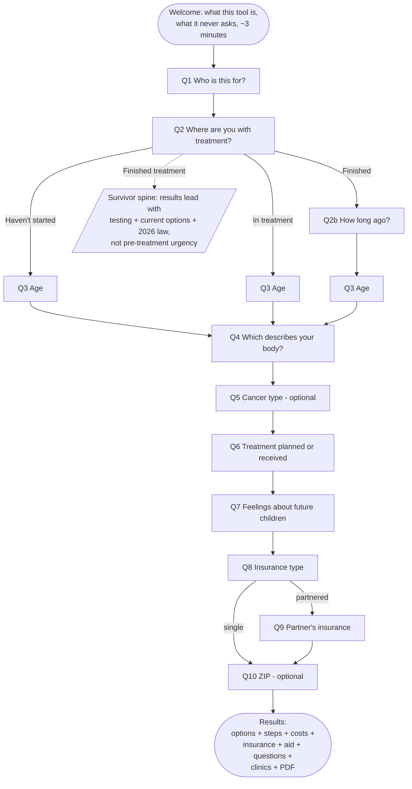

# Click-Through Question Flow — v0 for checkpoint 1 review

Last reviewed: 2026-10-30. One question per screen, back button everywhere, "Not sure" or "Skip" on every screen. Nothing leaves the device.

## Design rules carried into the flow

- Treatment stage comes EARLY (Q2) because it gates everything: survivors get a different spine than people who haven't started treatment, and nobody gets asked questions that don't apply to them.
- "Not sure" is a first-class answer that routes to real content ("here's how to find out, and it's okay not to know"), never to a dead end.
- Optional questions say why we're asking and what we do with the answer, in one line, on the screen itself.
- No question about member IDs, policy numbers, plan names, diagnosis details beyond an optional cancer-type picker.

## Questions

| # | Question | Answers | Notes |
|---|----------|---------|-------|
| Q1 | Who is this for? | Just me / Me and my partner | ~70% single; "just me" is the first option |
| Q2 | Where are you with treatment? | Haven't started yet / In treatment now / Finished treatment | The main fork. "Finished" asks a follow-up: less than 1 year ago / 1-5 years / more than 5 years / not sure |
| Q3 | How old are you? | Number entry with large stepper, 15-45 emphasis but accepts any | Age changes options and aid eligibility |
| Q4 | Which describes your body? | Ovaries and/or uterus / Testes / Prefer to self-describe / Prefer not to say | Asked as anatomy, not gender; one-line note on why it matters. "Prefer not to say" shows both content tracks |
| Q5 | What type of cancer? (optional, skippable) | Common AYA list + search + "Skip" | Only used to tailor "questions for your doctor" |
| Q6 | What treatment is planned or happened? (multi-select) | Chemotherapy / Radiation / Surgery / Stem cell or bone marrow transplant / Not sure yet | If chemo: optional "do you know which drugs?" free-text + "not sure" (feeds risk module later). If radiation: "where on your body?" with simple body regions + not sure |
| Q7 | How do you feel about having children someday? | Yes, I want to / Maybe / Not sure / No | "No" still gets gentle info (feelings can change, no pressure either way); never a guilt screen |
| Q8 | What health insurance do you have? | Job or private plan based in California / Medi-Cal / Other or out-of-state / None / I don't know | "I don't know" routes to the benefit-verification explainer (from D4 patient guide) |
| Q9 | (only if Q1 = partner) Does your partner have insurance through work? | Yes / No / Not sure | A partner's plan can cover fertility care |
| Q10 | ZIP code (optional, skippable) | 5-digit entry | "Used only to measure distance to clinics on this device. It never leaves your phone." |

Then: **Results page** assembled from answers (options that fit, costs, insurance path, aid, questions for your doctor, clinic map, PDF download).

## Flow diagram

## Open questions for Helen at checkpoint 1

1. Q4 wording: current draft asks about anatomy with "prefer to self-describe." Good, or do you want Estella's team to word this one?
2. Q6 chemo drug names: free text now (stored for the future risk module) or drop until Hannah's document arrives?
3. Survivors and Q7: should "No" end with a short results page anyway (testing info, emotional support resources) rather than skipping to the end? Current draft: yes, short results page.
4. Do we ask Q5 cancer type at all in v1, given it only feeds the doctor-questions list?
